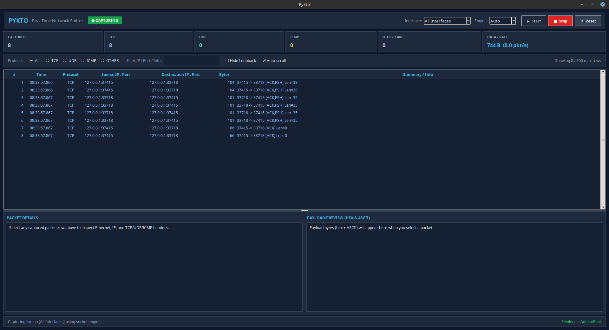
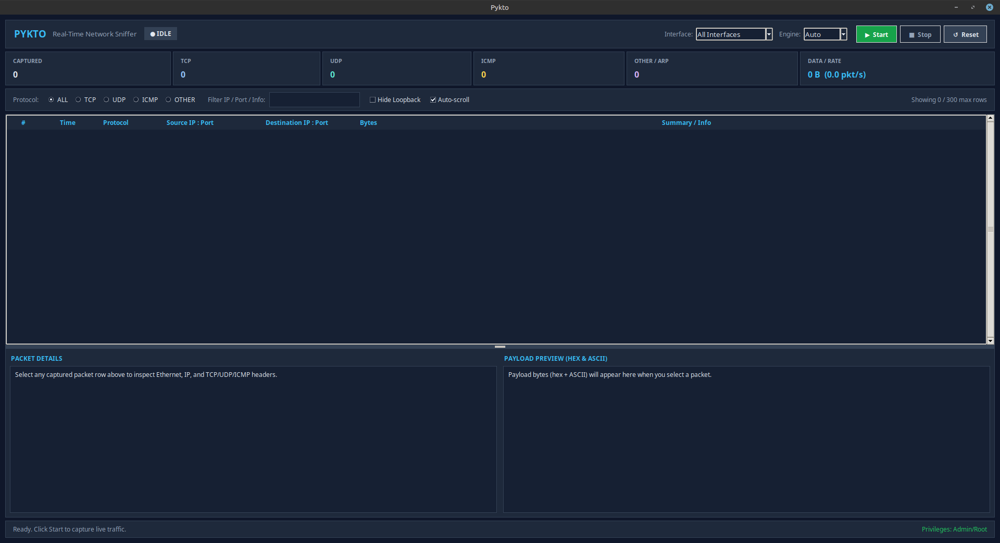
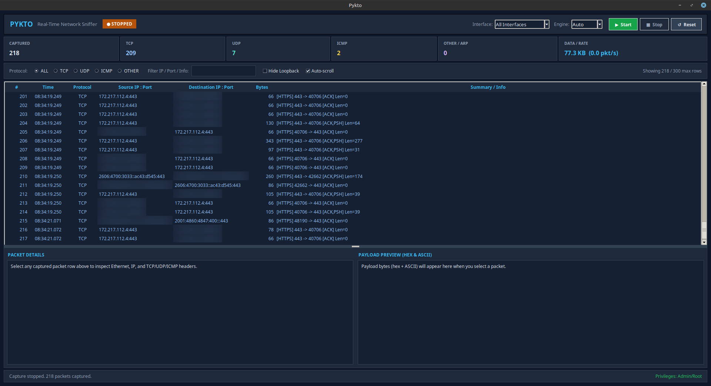

# Pykto (`CodeAlpha_Pykto`)

**Pykto** is a standalone Python desktop network sniffer built with Tkinter, Python raw `socket`, and `scapy`. It opens directly as a desktop GUI (no localhost web server required), automatically bootstraps its virtual environment on first run, and displays live network packets in a bounded table with real-time statistics and an interactive packet/payload inspector.

---

## Demo Video

[](untitled.mp4)

> **[▶ Watch / Download Demo Video (`untitled.mp4`)](untitled.mp4)**

**What the walkthrough demonstrates:**
1. **Clone & First-Run Bootstrap**: Cloning `CodeAlpha_Pykto` and launching `sudo -E python3 Snifx/app.py`, which automatically creates `Snifx/venv`, installs `scapy==2.8.0` from [`requirements.txt`](requirements.txt), and opens the desktop GUI.
2. **Engine Switching (`Auto` / `Socket` / `Scapy`)**: Starting, stopping, and resetting live packet captures across all three capture modes from the top toolbar.
3. **Live Packet & Payload Inspection**: Viewing real-time protocol/rate cards and selecting captured rows to inspect decoded headers (**PACKET DETAILS**) alongside the **PAYLOAD PREVIEW (HEX & ASCII)** pane.

---

## Screenshots

### Dashboard (Idle)


### Live Packet Capture (`▶ Start`)


### Stopped Capture (`■ Stop`)


### Reset (`↺ Reset`)


---

## Key Features

- **Simple Controls**: One-click **Start**, **Stop**, and **Reset** buttons.
- **No Terminal / Text Flooding**: Displays 1 compact row per packet and keeps at most **300 visible rows** in the live table (`MAX_VISIBLE_ROWS = 300`) backed by a **1,000-packet** ring buffer (`MAX_BUFFER_PACKETS = 1000`).
- **Real-Time Traffic Cards**: Live counters for `CAPTURED`, `TCP`, `UDP`, `ICMP`, `OTHER / ARP`, and `DATA / RATE` (total bytes + packets/sec).
- **Packet & Payload Inspector**: Click any packet row to inspect Ethernet MACs, IPv4/IPv6 headers, TCP flags/sequence numbers, UDP/ICMP fields, and a Hex + ASCII payload preview (up to 512 bytes).
- **Live Filtering**: Filter by protocol (`ALL`, `TCP`, `UDP`, `ICMP`, `OTHER`), search by IP/port/summary text, toggle `Hide Loopback` (`127.x` / `::1`), and toggle `Auto-scroll`.
- **Automatic Environment Bootstrap**: Launching `Snifx/app.py` or `Snifx/scapy_version.py` automatically sets up `Snifx/venv` and installs dependencies on first run.

---

## Tools & Technologies Used

| Category | Tool / Library | Purpose in Pykto |
|---|---|---|
| Language | **Python 3** (tested on 3.12.3) | Core application logic, concurrency, and binary parsing |
| Desktop UI | **Tkinter (`tkinter` / `ttk`)** | Native desktop window, live `Treeview` packet table, stat cards, filters, and inspector |
| Packet Capture (Built-in) | **`socket`** (`AF_PACKET` / `AF_INET`) | Zero-dependency raw socket packet capture on Linux (and IPv4 raw sockets on Windows) |
| Packet Capture (Optional) | **`scapy`** (tested with 2.8.0) | Cross-platform packet sniffing via `AsyncSniffer` (`Scapy` engine mode) |
| Header Unpacking | **`struct`** | Unpacking Layer 2 (Ethernet/ARP), Layer 3 (IPv4/IPv6), and Layer 4 (TCP/UDP/ICMP) headers |
| Concurrency & Buffering | **`threading`**, **`queue.Queue`**, **`collections.deque`** | Non-blocking background capture and bounded real-time UI updates |
| Privilege Elevation (Linux) | **`sudo`**, **`setcap`**, **`pkexec`** | Granting `CAP_NET_RAW` / root access required for raw packet capture |
| Testing | **`unittest`** | Automated packet-parser and Tkinter UI integration tests |

---

## Requirements

- **Python**: Python **3.10+** (uses `@dataclass(slots=True)` and PEP 585 type hints). On Ubuntu/Debian/Kali Linux, ensure `python3-venv` is installed if using automatic virtual environment setup (`sudo apt install -y python3-venv`).
- **GUI Toolkit**: `tkinter` (built into standard Python on Windows/macOS; on Ubuntu/Debian/Kali Linux install with `sudo apt install -y python3-tk` if missing) plus an active desktop display (`DISPLAY` / `XAUTHORITY` on X11).
- **Third-Party Packages**:
  - **None required** to run with the built-in `Socket` engine on Linux.
  - **`scapy==2.8.0`** *(optional, listed in [`requirements.txt`](requirements.txt))* — required only if you select the `Scapy` capture engine (automatically installed into `Snifx/venv` on first launch or via [`setup_env.sh`](setup_env.sh)). On Windows, `Npcap` is also needed for `scapy` L2 sniffing.
- **System Privileges**:
  - **Linux**: Root (`sudo -E`) or `cap_net_raw,cap_net_admin=eip` capability on the Python binary.
  - **Windows**: Run terminal/Python as **Administrator**.

---

## Setup Environment

Running `Snifx/app.py` (or `Snifx/scapy_version.py`) automatically creates `Snifx/venv`, installs packages from [`requirements.txt`](requirements.txt) when missing or updated (tracked via `.requirements.sha256`), and re-execs inside the virtual environment. Set `PYKTO_NO_AUTO_VENV=1` if you want to skip automatic virtual environment setup.

You can also set up or recreate the environment ahead of time with [`setup_env.sh`](setup_env.sh):

```bash
./setup_env.sh
# Or rebuild Snifx/venv from scratch:
./setup_env.sh --recreate
```

Or create the virtual environment manually:

```bash
python3 -m venv Snifx/venv
./Snifx/venv/bin/pip install -r requirements.txt
```

---

## Working Methods (How Pykto Works)

1. **Packet Capture (`Snifx/capture_engine.py`)**
   - **`CaptureEngine`** runs packet capture on a background thread so the GUI never freezes.
   - **Raw `socket` engine (`_start_raw_socket`)**:
     - On Linux, opens `socket.socket(socket.AF_PACKET, socket.SOCK_RAW, socket.ntohs(0x0003))` with a `0.25s` timeout so stopping is responsive.
     - On Windows, uses `AF_INET` + `SOCK_RAW` with `SIO_RCVALL`.
   - **`scapy` engine (`_start_scapy`)**:
     - Uses `scapy.sendrecv.AsyncSniffer` with `store=False` so packets are processed as a stream instead of piling up in RAM.
   - **`Auto` mode**:
     - Automatically selects fast built-in `AF_PACKET` raw sockets on Linux, or `scapy` on platforms without `AF_PACKET`.

2. **Packet Unpacking & Analysis (`Snifx/packet_parser.py`)**
   - **`parse_raw_ethernet_frame`** and **`parse_scapy_packet`** decode each captured packet into a unified `PacketRecord`:
     - **Layer 2 (Data Link)**: Source/destination MAC addresses, EtherType (`0x0800` IPv4, `0x86DD` IPv6, `0x0806` ARP).
     - **Layer 3 (Network)**: IPv4/IPv6 version, TTL/Hop Limit, source IP, destination IP, and transport protocol number.
     - **Layer 4 (Transport)**:
       - **TCP**: Source/destination ports, flags (`SYN`, `ACK`, `PSH`, `FIN`, `RST`, `URG`), sequence & acknowledgment numbers, and payload length.
       - **UDP**: Source/destination ports, UDP length, and payload.
       - **ICMP / ICMPv6**: Type (e.g., Echo Request/Reply), code, checksum, and payload.
     - **Service Hints & Payload Dump**: Labels common ports (`HTTP`, `HTTPS`, `DNS`, `SSH`, `FTP`, `SMTP`, etc.) and renders payload bytes via `format_payload_hexdump`.

3. **Real-Time UI Pipeline (`Snifx/app.py`)**
   - Captured `PacketRecord` objects are pushed into a thread-safe `queue.Queue` (max 5,000 items).
   - Every `100 ms`, `SnifxApp._poll_loop` drains up to 300 queued packets in a batch, updates the protocol/byte counters, calculates the live `pkt/s` rate once per second, and appends matching rows to the `Treeview` while pruning rows beyond `300`.

---

## Instructions: Launching, Starting, Stopping, and Resetting

### 1. Launch the Application

Raw packet capture on Linux requires elevated network privileges (`root` or `CAP_NET_RAW`):

```bash
# Launch directly (auto-creates Snifx/venv and installs requirements on first run)
sudo -E python3 Snifx/app.py

# Or launch explicitly with the project virtual environment
sudo -E ./Snifx/venv/bin/python Snifx/app.py
```

> **Note:** `sudo -E` preserves `DISPLAY` and `XAUTHORITY` so the desktop window can connect to your graphical session.

Optional — grant capture capabilities once to your Python binary so you can run without `sudo`:

```bash
sudo setcap cap_net_raw,cap_net_admin=eip $(readlink -f $(which python3))
python3 Snifx/app.py
```

---

### 2. How to Start the Capture Process

1. **(Optional) Select an Interface** from the **Interface** dropdown (`All Interfaces` captures across every active interface, or pick a specific interface such as `eth0`, `wlan0`, or `lo`).
2. **(Optional) Select an Engine** from the **Engine** dropdown (`Auto`, `Socket`, or `Scapy`).
3. Click **`▶ Start`**:
   - The status badge changes from `● IDLE` (or `● STOPPED`) to **`● CAPTURING`** (green).
   - `Interface` and `Engine` selectors lock while capture is active, `▶ Start` is disabled, and `■ Stop` becomes enabled.
   - Live packets immediately begin appearing in the table and updating the summary cards in real time.
   - *(If launched without root/capture permissions, Pykto shows a permission dialog with the exact `sudo -E` / `setcap` command or an option to relaunch via `pkexec`.)*

---

### 3. How to Inspect & Filter Live Traffic

- **Protocol filter**: Click `ALL`, `TCP`, `UDP`, `ICMP`, or `OTHER` to focus on specific traffic types.
- **Text filter**: Type an IP address, port number, or keyword into **Filter IP / Port / Info** to narrow visible rows instantly.
- **Hide Loopback**: Check **Hide Loopback** to exclude `127.x.x.x` and `::1` traffic.
- **Auto-scroll**: Keep **Auto-scroll** checked to follow newest packets, or uncheck it to pause scrolling while reading older rows.
- **Inspect a packet**: Click any row in the table to view its full header breakdown on the bottom-left (**PACKET DETAILS**) and its hex/ASCII bytes on the bottom-right (**PAYLOAD PREVIEW**).

---

### 4. How to Stop the Capture Process

1. Click **`■ Stop`** in the top toolbar:
   - Signals `CaptureEngine.stop()` to close the raw socket / stop `AsyncSniffer` cleanly.
   - The status badge changes to **`● STOPPED`** (amber).
   - `▶ Start` is re-enabled and `Interface` / `Engine` dropdowns are unlocked.
   - **All captured packets, counters, and filters remain visible** so you can continue inspecting or filtering what was captured.

---

### 5. How to Reset the Process

1. Click **`↺ Reset`** in the top toolbar (works whether capture is **stopped** or **currently running**):
   - Drains any buffered packets still waiting in the queue.
   - Clears all rows from the live packet table and clears the 1,000-packet ring buffer.
   - Resets packet numbering back to `#1` and resets `CAPTURED`, `TCP`, `UDP`, `ICMP`, `OTHER / ARP`, and `DATA / RATE` back to `0`.
   - Clears the **PACKET DETAILS** and **PAYLOAD PREVIEW** panes.
   - If capture was stopped, the status badge returns to `● IDLE`; if capture was running, it continues capturing fresh packets from `#1`.

---

### Optional CLI Sniffers

Pykto also includes two terminal-only sniffers under `Snifx/`:

```bash
# Built-in raw socket CLI sniffer (no third-party dependencies)
sudo python3 Snifx/sniffer.py

# Scapy CLI sniffer (supports packet count -c and interface -i flags)
sudo python3 Snifx/scapy_version.py -c 20 -i eth0
```

---

## Project Structure

- `untitled.mp4` — End-to-end walkthrough demo video of cloning, bootstrapping, capturing, inspecting, stopping, and resetting Pykto
- `setup_env.sh` — Script to create or `--recreate` `Snifx/venv` and install requirements
- `requirements.txt` — Python package dependencies (`scapy==2.8.0`)
- `Snifx/app.py` — Pykto Tkinter desktop GUI (`SnifxApp`)
- `Snifx/env_bootstrap.py` — Auto-creates `Snifx/venv` and installs `requirements.txt` on launch
- `Snifx/capture_engine.py` — Real-time background capture controller (`CaptureEngine`)
- `Snifx/packet_parser.py` — Raw socket & Scapy packet unpacker and hex dump formatter
- `Snifx/test_snifx.py` — Automated unit and Tkinter UI integration tests
- `Snifx/sniffer.py` — Optional terminal raw-socket sniffer
- `Snifx/scapy_version.py` — Optional terminal `scapy` sniffer
- `Snifx/src/` — Dashboard, live capture, and stopped state screenshots

---

## Running Tests

```bash
./Snifx/venv/bin/python Snifx/test_snifx.py
```